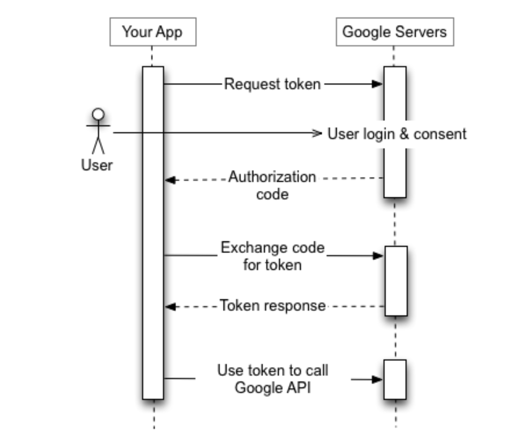
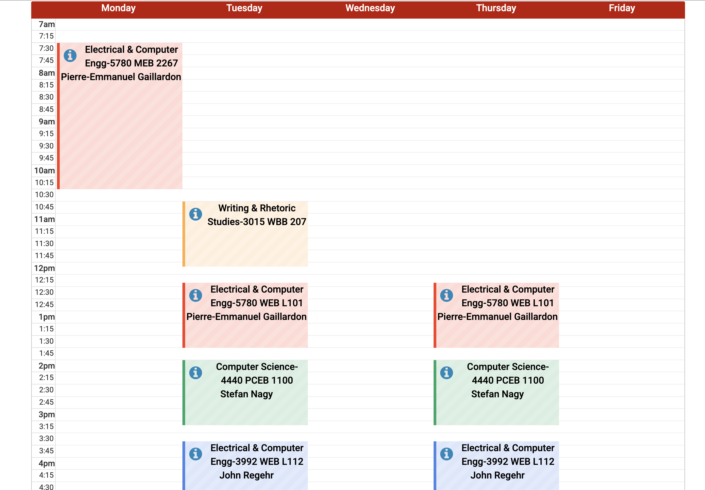
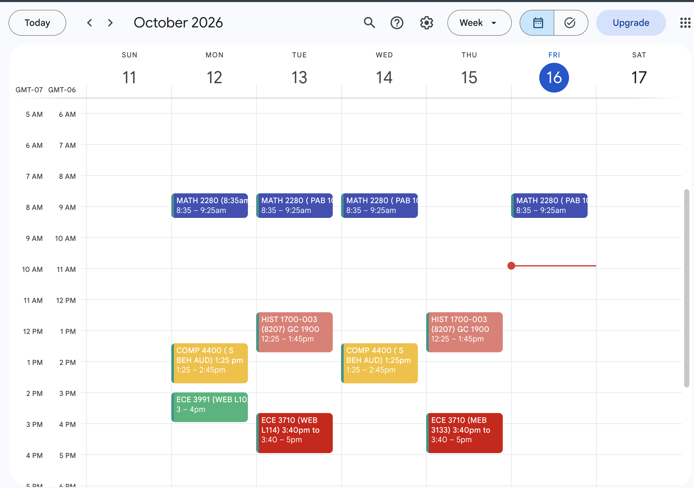

# NetSentry Backend

NetSentry is the backend for a web app that turns schedule images into Google Calendar events. I started it after getting tired of manually adding each of my course schedules to Google Calendar.

## Goal

1. Sign in with Google.
2. Upload an image of a schedule.
3. Use AI to extract event details into structured JSON.
4. Map the JSON to Google Calendar events and add them automatically.

## Current status

I'm integrating Google OpenID Connect authentication with Ollama's `qwen3-vl:4b` vision model. **Ollama currently runs locally on my machine.** In production, I plan to use an API-key-authenticated model endpoint instead. Automatic event creation is still in progress.

## Tech stack

Java, Spring Boot, Spring Security, Spring AI, Ollama (`qwen3-vl:4b`), and Google Calendar API.

## Google authentication flow

Spring Security handles the OAuth 2.0 authorization-code flow and Google's callback. The backend then uses the authorized access token to call Google Calendar.

## Success Criteria

The goal is to convert an uploaded schedule image into Google Calendar events automatically.

### Input: Course Schedule

### Expected Output: Google Calendar

